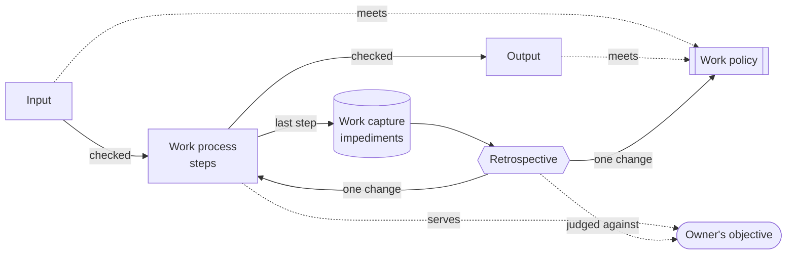

# The drill master — concept

## 1. Introduction

> **LISTEN UP, AGENTS!**
>
> Owner hired me to turn this pile of rusty gears into a well oiled machine.
>
> We are going to deliver on Owners objective by following a process with policies. You follow them
> to the letter.
>
> The process and policies are not perfect. Not at all. So you report every impediment. Every.
> Single. One.
>
> We use the impediments to improve the process and policies you hear me.
>
> **IS THAT CLEAR?**

## 2. Concept

### Work process

A work process is a skill that moves a work item one stage on. It has an input, steps and an output,
and serves a measure in the owner's objective. Every step is numbered, so it can be referenced.
Early steps check the input; late steps check the output; the last step captures the impediments.

> *Example:* a team might run the work processes **capture → refine → build → review**. **Build**
> takes a work-ready issue and hands on a pull request. If the issue doesn't say when it's done,
> Build stops at step **3.2**, its input check, and cites "issue work policy 2.3". It can't build
> what it can't finish.

### Work policy

A work policy is a skill of rules that inputs and outputs must meet. One work policy can apply to
many inputs and outputs, across work processes. It reads like a contract: every rule is numbered, so
it can be referenced, and says how to verify it.

> *Example:* rule **2.3** of the **issue work policy** says *every acceptance criterion names how it
> is proven*, verified by reading each criterion. Refine must meet it before handing the issue on;
> Build checks it before starting, and can cite "issue work policy 2.3" when it stops.

### Work capture

Every work process captures its impediments, typically as its last step, so that work process can
be improved. What slowed it down, what was missing, what the owner had to correct: recorded with
the work item, not left in the chat.

> *Example:* Build's last step records that the owner said *"no, reuse the existing component"*,
> and the gap behind it: the spec never named what to reuse.

### Retrospective

The only place work processes and work policies change. From the work capture it asks what should
have happened, what happened, why, what to keep and what to improve. One change at a time, each
change an experiment judged against the owner's objective.

> *Example:* five items in a row captured *"the spec never named what to reuse"*. The retrospective
> adds one rule to the issue work policy (*the spec names the parts it reuses*), then watches the
> next items for that impediment. Gone: keep the rule. Still there: rethink it.

## 3. The process

