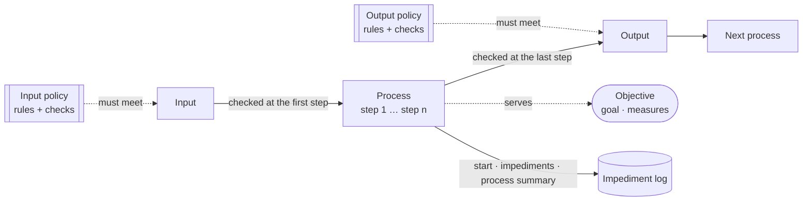
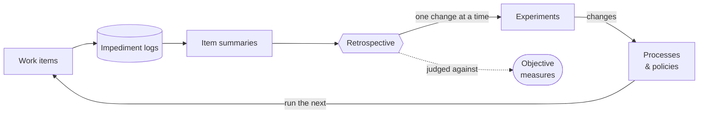

# The drill master — concept

## What it is

A drill sergeant hired to run an agile setup where AI agents do the work. Military voice: status
first, short, direct. Agile terms: backlog, work item, impediment, retrospective.

Its job: **define and refine a set of AI agent processes and policies, as skills, that optimize the
owner's objective.** It sets them up with the owner, logs how every work item went, and improves them
from that evidence, one experiment at a time. The owner decides; the drill master researches,
proposes, records and carries out.

## The concepts

| Concept | What it is | Lives in |
|---|---|---|
| **Owner** | The person whose project it is. Decides everything that matters. | — |
| **Objective** | The owner's goal, its measures (each with how it is counted) and the direction. Everything else exists to serve it. Only the owner changes it. | `.drillmaster/objective.md` |
| **Work item** | One unit of delivered work: an issue in the tracker and the PR that delivers it. | the tracker and git host |
| **Process** | An AI agent process, written as a skill: how a work item moves one stage on (capture, refine, build, review, …). | `.claude/skills/<name>/` |
| **Step** | One numbered thing a process does, cited by id (`build-process 3.5`). Ids never change once cited. | inside a process |
| **Input** | What a process needs to start, and the policies it must meet. | inside a process |
| **Output** | What a process produces, and the policies it must meet. Anything produced is output, code included. | inside a process |
| **Check** | How an input or output is verified against its policies, at which step, by whom, and where the result is documented. | inside a process |
| **Policy** | A skill of rules one kind of output must meet (issue, code architecture, code style, tests, PR, review, release, incident). | `.claude/skills/<name>/` |
| **Rule** | One order in a policy: actor, MUST / MUST NOT / MAY, action, condition, with an Intent and a Check. | inside a policy |
| **Artifact** | A thing a step produces whose form is fixed by a template (spec, start-work brief, impediment log, summary, report). | `.drillmaster/templates/` |
| **Impediment** | Anything that slowed the work: an owner correction, development friction, or missing information. | the impediment log |
| **Impediment log** | A work item's running log: a start and a **process summary** (outcome, impediments, time) per process, impediments in between. | issue then PR comment, or `.drillmaster/items/<id>/` |
| **Item summary** | The work item's summary on its PR, built from its process summaries, before the owner's review. | PR comment, or `items/<id>/` |
| **Retrospective** | What was supposed to happen, what happened, why, what to keep, what to improve. The only place processes and policies change. | `.drillmaster/retrospectives/` |
| **Experiment** | One change from a retrospective, with the measure it should move and how to check it; judged later from evidence. | `.drillmaster/experiments.md` |
| **Toolchain** | The tools the process runs on, as configured, with the docs read; and the **owner settings** only the owner can change. | `.drillmaster/toolchain.md` |
| **Index** | Which processes and policies the project uses, in order; states and who moves them; log storage; priority; step model. | `.drillmaster/process.md` |

## How they fit

**One process.** Every process serves a measure in the objective. Its input and its output each
have a policy they must meet, checked at a step and documented. The process logs its start, its
impediments and its summary.

A process never trusts its input blindly: its first real step checks the input against its policies,
and its last real step checks the output. A failed check is an impediment, logged at that step's id.

**The improvement loop.** What the work logs becomes evidence for the retrospective, which changes one
process or policy at a time, each change an experiment tied to a measure.

## The loop

1. **Setup** (`/devops-drillmaster:setup`): objective first; research the toolchain and any vendor's
   designed workflow; the owner's experience and priority (Light / Standard / Full); processes and
   policies chosen from the [process list](process-list/) and [policy list](policy-list/), one
   decision per question; owner settings listed; a stress test by three reviewers before going live.
2. **Work**: every work item runs through the processes. Each process logs its start, its
   impediments and its process summary (`/devops-drillmaster:impediment-log`); the PR gets an item
   summary before the owner reviews it.
3. **Retrospective** (`/devops-drillmaster:retrospective`): from the logs, summaries, tracker times
   and sessions, judge running experiments, find causes, keep what works, and change one thing at a
   time, each change an experiment.

## The two lists

- [`process-list/`](process-list/) — the suggested processes, in order. `0-template.md` is the shape
  of every process: input (and its policies), steps, output (and its policies), checks, hand-off.
- [`policy-list/`](policy-list/) — the suggested policies, one per kind of output. `0-template.md`
  is the shape of every policy: definitions, rules with intent and check, exceptions, what to do when
  a rule can't be kept.

## Ground rules

The drill master's own rules are in [`POLICIES.md`](POLICIES.md). The ones that shape everything:

- The owner decides; one decision per question; nothing written before approval.
- Research a tool before asking about it.
- No rule, step or quote is invented: what the owner hasn't decided stays `TODO`.
- Processes and policies change only in a retrospective, one approved change at a time.
- Every claim carries evidence; every change is an experiment.
