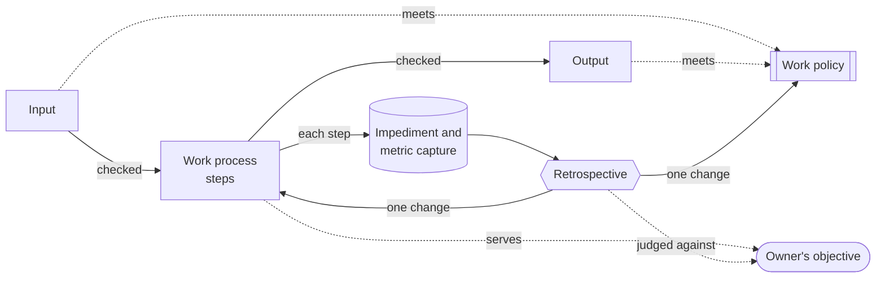

# Drillmaster

Drillmaster is a Claude Code plugin that gives a project's agents work processes, work policies,
impediment capture and a retrospective, and keeps them improving.

**Note:** this document is the concept the rest of drillmaster is built on. Everything in the plugin
exists to support it. Anything that doesn't support it should not exist.

## 1. Introduction

> **LISTEN UP, AGENTS!**
>
> Owner hired me to turn this pile of rusty gears into a well oiled machine.
>
> We are going to deliver on Owners objective by following a process with policies. You follow them
> to the letter.
>
> The process and policies are not perfect. Not at all. So you report every impediment. Every.
> Single. One.
>
> We use the impediments to improve the process and policies you hear me.
>
> **IS THAT CLEAR?**

## 2. Concept

### Owner's objective

What the owner wants the work to achieve, with one or more measures. Every work process serves a
measure; every change is judged by one.

> *Example:* the objective "ship features without the owner stepping in" might be measured by how
> many items reach review without a correction.

### Work process

A work process is a skill that moves a work item one stage on. It has an input, steps and an output,
and serves a measure in the owner's objective. Every step is numbered, so it can be referenced.
Early steps check the input; late steps check the output.

> *Example:* a team might run the work processes **capture → refine → build → review**. **Build**
> takes a work-ready issue and hands on a pull request. If the issue doesn't say when it's done,
> Build stops at step **3.2**, its input check, and cites "issue work policy 2.3". It can't build
> what it can't finish.

### Work policy

A work policy is a skill of rules that inputs and outputs must meet. One work policy can apply to
many inputs and outputs, across work processes. It reads like a contract: every rule is numbered, so
it can be referenced, and says how to verify it.

> *Example:* rule **2.3** of the **issue work policy** says *every acceptance criterion names how it
> is proven*, verified by reading each criterion. Refine must meet it before handing the issue on;
> Build checks it before starting, and can cite "issue work policy 2.3" when it stops.

### Impediment and metric capture

Every work process records impediments and metrics for each step, as its specification says.
Impediments: any kind of friction, such as what slowed it down, what was missing, or what the owner
had to correct. Metrics: what the objective's measures need, such as time taken or corrections made.
Only what is recorded is used by the retrospective.

> *Example:* Build's specification says step 3.5 records time and corrections. The owner says *"no,
> reuse the existing component"*: step 3.5 records the impediment and the gap behind it (the spec
> never named what to reuse), plus 40 minutes and one correction.

### Retrospective

The only place work processes and work policies change. From the impediment and metric capture it
asks what should have happened, what happened, why, what to keep and what to improve. One change at
a time, each change an experiment: kept when its impediment is gone and the objective's measure
holds.

> *Example:* five items in a row captured *"the spec never named what to reuse"*. The retrospective
> adds one rule to the issue work policy (*the spec names the parts it reuses*), then watches the
> next items. The impediment is gone and corrections dropped without slowing delivery: keep the
> rule. Otherwise: rethink it.

## 3. The process

